# 粤乡智匠

**基于 AI 实训的农村本土人才赋能平台**

面向广东乡村的「农业技能培训 — 电商运营实训 — 非遗手工传承 — 本土资源服务 — 就业对接 — 社区交流」一体化平台。以真实产业场景为教学单元，由大模型承担农技问答、病虫害诊断、话术对练与简历辅助，把培训过程沉淀为可核验的技能档案，并直接对接企业岗位与政府政策。

<p>
  <strong>技术栈</strong>：Python 3 · Flask 2.3 · Vue 3.5 · TypeScript 5.7 · Vite 6 · Pinia · SQLite 3
</p>

[项目简介](#项目简介) · [核心功能](#核心功能) · [技术架构](#技术架构) · [快速开始](#快速开始) · [环境配置](#环境配置) · [团队信息](#团队信息)

---

## 项目简介

粤乡智匠把「培训」拆成可执行、可评分、可对接岗位的动作，而不是停留在课程视频与考试。平台服务六类角色：学员、教师、企业、政府、运营与超级管理员，每类角色拥有独立工作台与明确的数据边界。

平台围绕三条断点设计：

| 断点 | 现状 | 平台的做法 |
| --- | --- | --- |
| 学用脱节 | 培训内容与本地产业需求对不上 | 以广东特色作物、非遗技艺、电商岗位为教学单元，实训任务直接取自产业场景 |
| 农技服务不可及 | 农户遇到病虫害缺少即时、可信的指导 | 症状描述 + 照片的多模态诊断，结论标注来源与置信度，并给出用药免责声明 |
| 成果无法证明 | 学习记录散落，企业无法核验 | 课程、实训、证书、积分、能力档案统一沉淀，企业按档案筛选与投递 |

AI 不是装饰：农技问答、病虫害诊断、带货话术、商品文案、客服对练、方言语音问答、简历辅助都由上游模型驱动；任一模型未配置时，相关接口返回明确的「未启用」状态，不返回伪造结果。

## 核心功能

### 学员端

| 板块 | 主要功能 | 关键技术点 |
| --- | --- | --- |
| 农业技能培训 | 农技问答（流式输出）、追问建议、农事日历、作物订阅与到期提醒 | SSE 流式响应、按作物/月份筛选、节气与物候期匹配 |
| 病虫害防治 | 智能诊断（文字 + 最多 3 张照片）、病虫害速查（8 类作物 / 69 条） | 多模态模型调用、服务端分页筛选、用药剂量正则校验与免责声明 |
| 电商运营实训 | 带货话术、商品文案、客服对练、直播模拟、实训历史 | 分场景提示词、语速与口语化评分、多轮对练状态机 |
| 手工技艺传承 | 技艺详情、分步图文、采购指南与预算、视频教学、3D 模型查看 | 步骤与材料结构化落库、`model-viewer` 渲染 |
| 本土资源 | 方言语音问答、成功案例、政策信息 | 方言降级话术库、案例与政策读库组装 |
| 就业对接 | 岗位浏览与筛选、相似推荐、在线简历、AI 简历辅助、投递、收藏 | 能力档案与岗位匹配、简历完整度判定 |
| 社区交流 | 讨论列表与详情、发帖、评论、站内信、通知 | 敏感词初筛转人工、待审内容断链、评论计数一致性 |

### 管理与服务端

| 角色 | 工作台能力 |
| --- | --- |
| 教师 | 学员名册与账号绑定、实训批改、学情分析、课程与材料管理、3D 模型上传、AI 教学报告 |
| 企业 | 岗位发布与维护、投递处理、企业资质认证、招聘数据统计 |
| 政府 | 政策发布与下架、区域数据大屏 |
| 运营 | 农时、病虫害、技艺、方言、招募、案例六类内容维护 |
| 超级管理员 | 用户管理、内容审核（课程/岗位/3D 模型）、全员公告、社区内容治理、企业认证审核 |

## 界面预览

<p align="center">
  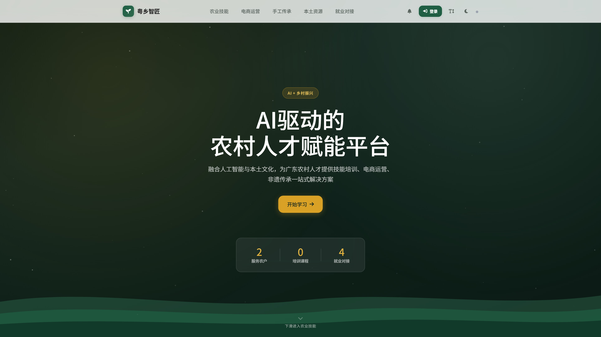
  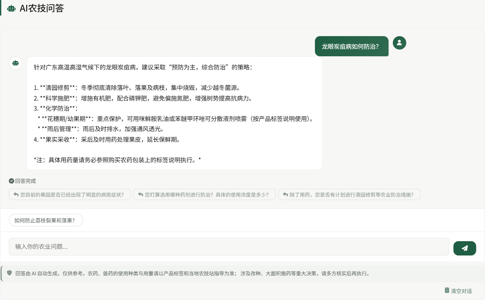
</p>

<p align="center">
  <em>左：首页 · 右：农技问答（流式输出 + 追问建议）</em>
</p>

<p align="center">
  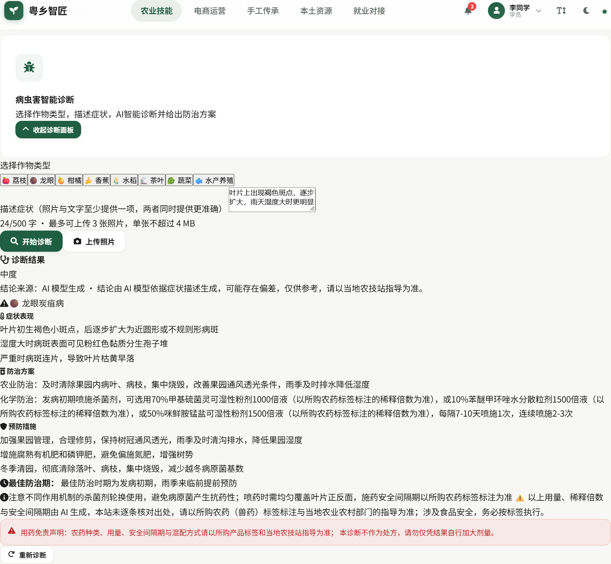
</p>

<p align="center">
  <em>病虫害智能诊断：症状描述与照片双通道输入，输出置信度、防治方案与用药免责声明</em>
</p>

<p align="center">
  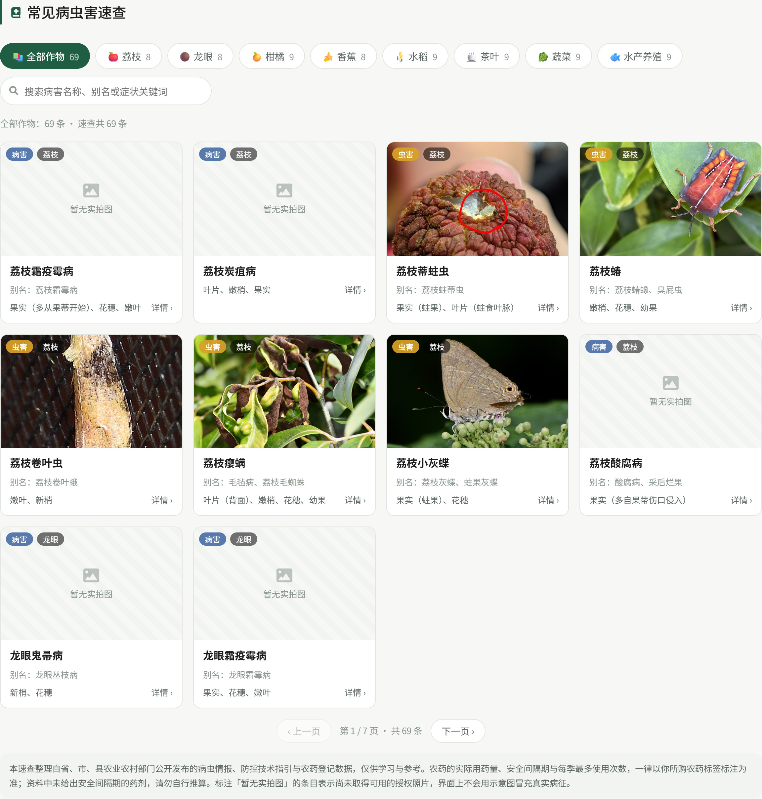
</p>

<p align="center">
  <em>病虫害速查：69 条、8 类作物，支持按作物筛选与关键词检索，标注来源与授权实拍图</em>
</p>

<p align="center">
  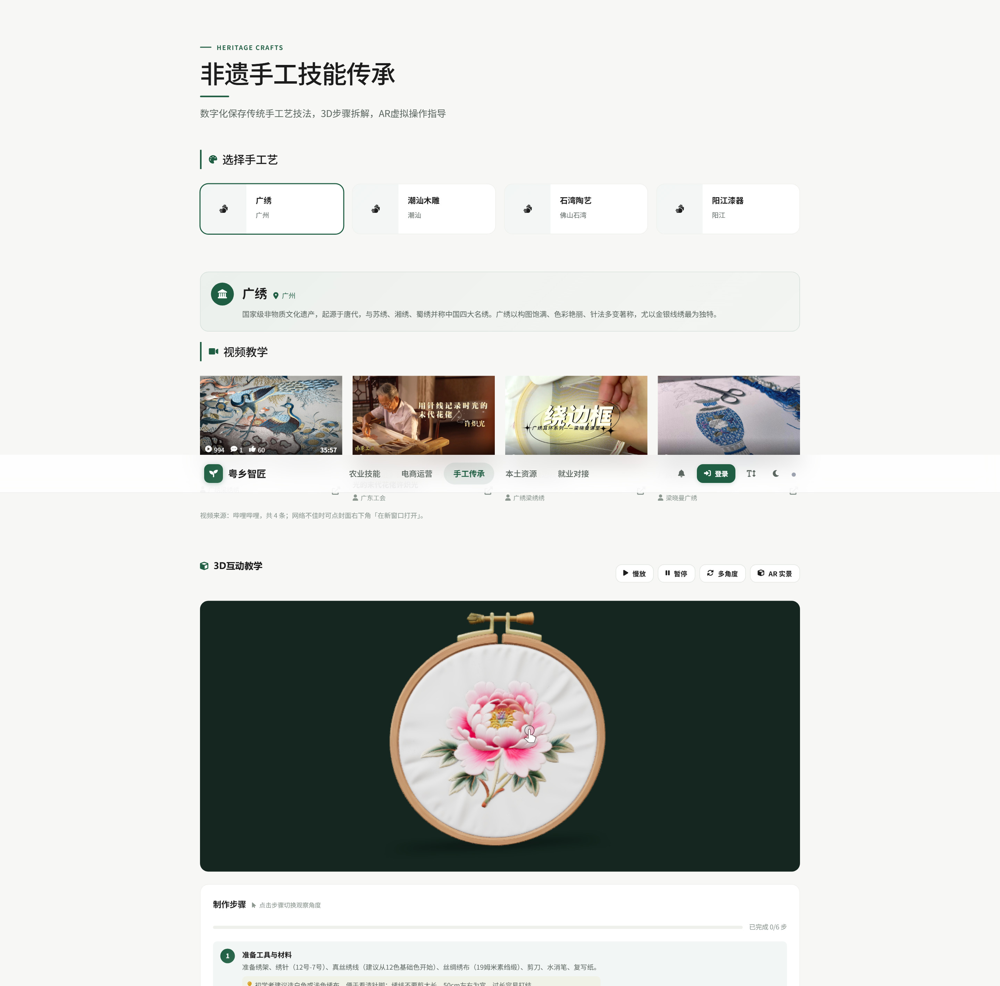
</p>

<p align="center">
  <em>非遗手工技艺：3D 互动教学、多角度查看、视频教学与分步制作指导</em>
</p>

<p align="center">
  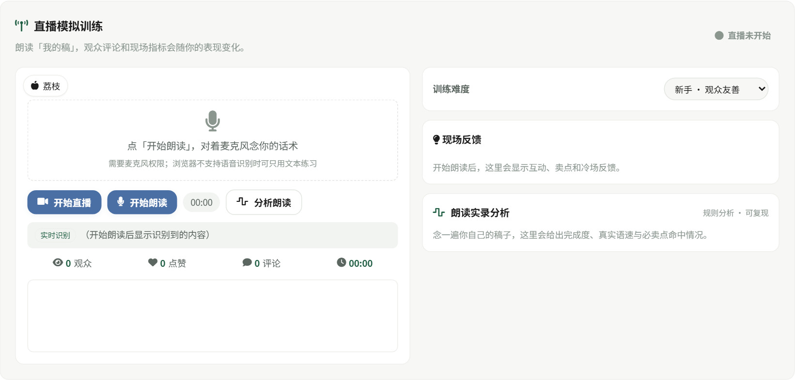
</p>

<p align="center">
  <em>直播模拟训练：实时识别话术问题，输出语速、口语化与合规评分</em>
</p>

<p align="center">
  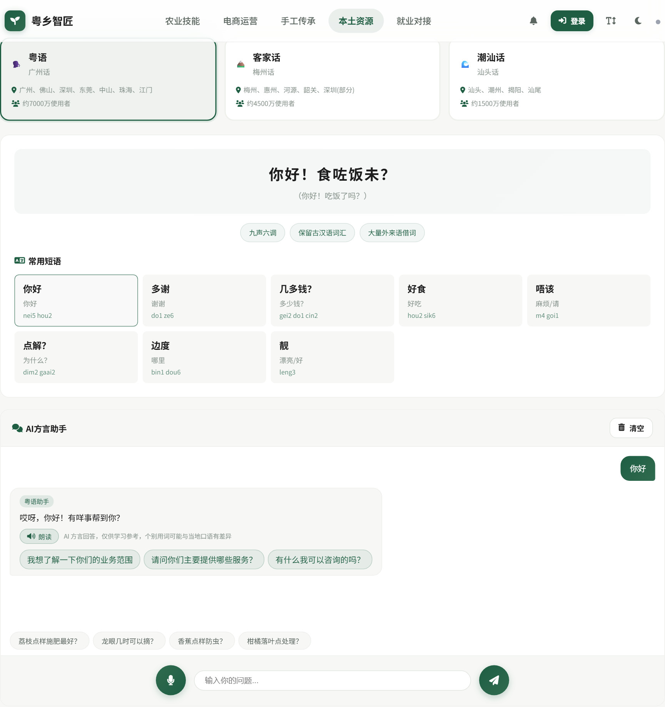
</p>

<p align="center">
  <em>方言语音问答：粤语、客家话、潮汕话三语种，支持语音输入、朗读与常用短语</em>
</p>

<p align="center">
  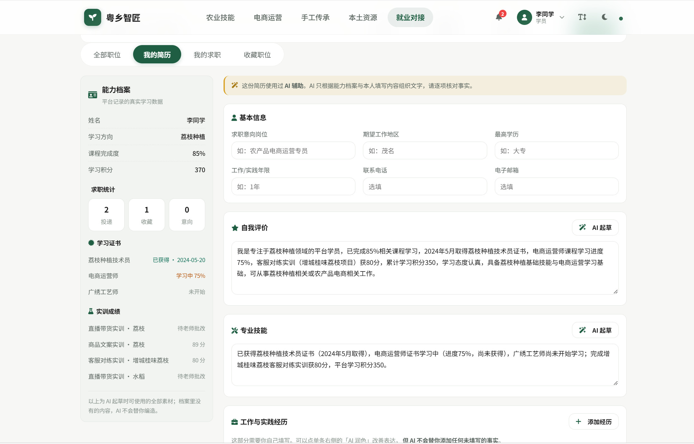
</p>

<p align="center">
  <em>AI 简历辅助：只引用能力档案与实训成绩中已有的事实，不代填未发生的经历</em>
</p>

<p align="center">
  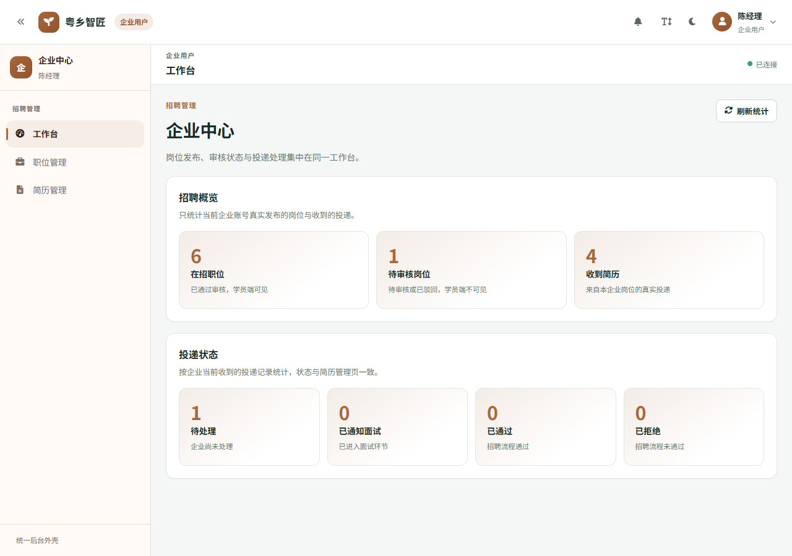
  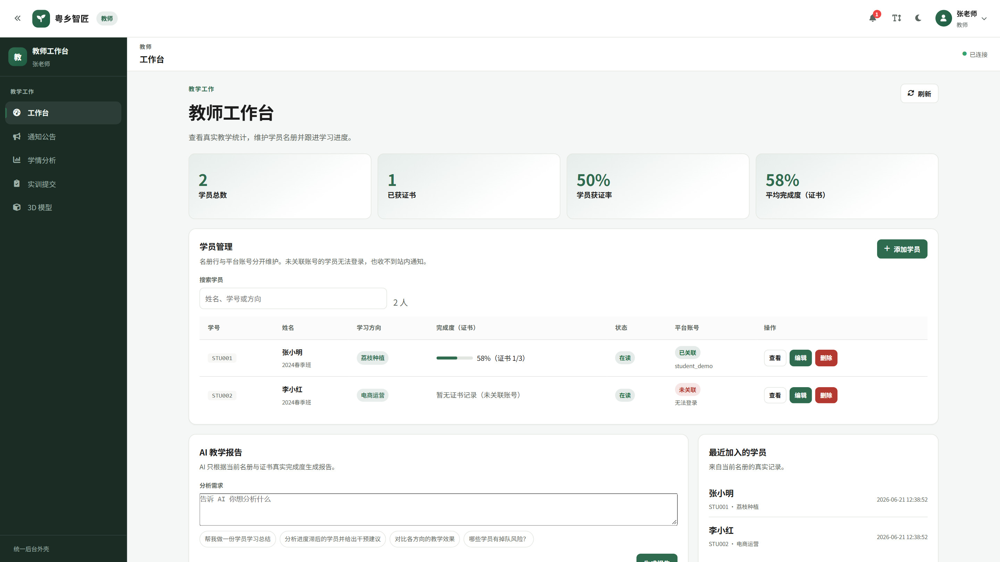
</p>

<p align="center">
  <em>左：企业工作台（岗位、投递与简历） · 右：教师工作台（名册、学情与 AI 教学报告）</em>
</p>

<p align="center">
  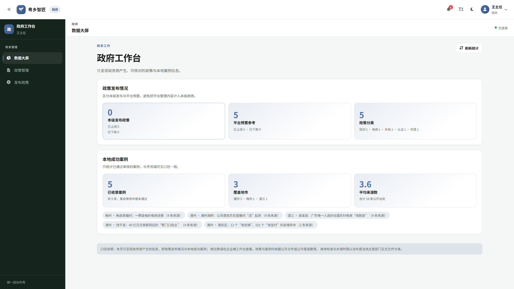
  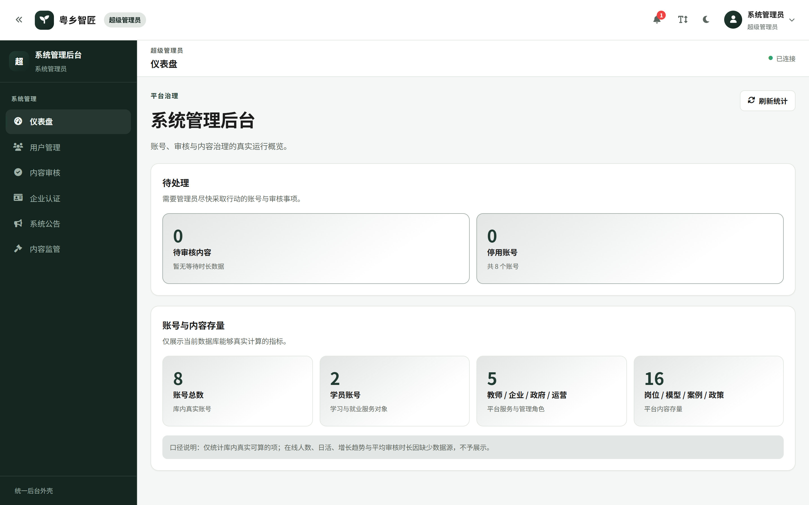
</p>

<p align="center">
  <em>左：政府工作台（政策与案例口径分离） · 右：管理员工作台（账号、审核与内容治理）</em>
</p>


## 技术架构

### 总体架构

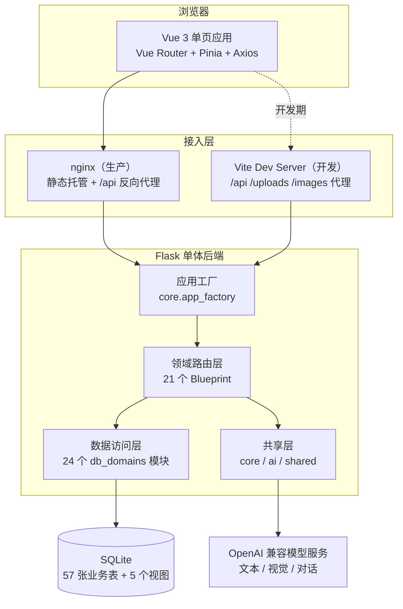

### 分层职责

| 层 | 目录 | 职责 | 约束 |
| --- | --- | --- | --- |
| 入口 | `backend/app.py`、`backend/run.py` | 创建应用、健康检查、启动 | 不承载业务路由 |
| 应用工厂 | `backend/core/` | 会话与鉴权、限流、CORS、统一错误响应 | 全站唯一实现 |
| 领域路由 | `backend/domains/<领域>/` | 一个领域一个 Blueprint | 领域之间不得互相 import |
| 数据访问 | `backend/db_domains/<领域>.py` | 一个领域一个数据模块 | 跨域取数走窄接口或只读视图 |
| 共享层 | `backend/shared/` | 零领域状态的纯函数与配置 | 不感知任何具体领域 |
| AI 出口 | `backend/ai/client.py` | 上游模型调用的唯一出口 | 业务代码不直连模型服务 |
| 前端 | `frontend/src/` | 视图、组件、路由、状态、请求封装 | 按页面域组织，样式走语义 token |

领域之间不互相 import 是硬约束，由 `tools/check_architecture.py` 机械校验；跨领域聚合由持有方显式调用对方窄接口，或走 5 个只读视图。

### 领域划分

21 个领域蓝图：`agriculture`（农技问答与农事日历）、`pest`（病虫害诊断与速查）、`crafts`（手工技艺）、`resources`（案例/政策/方言）、`ecommerce`（电商三条链路）、`live_training`（直播实训）、`employment`（岗位与投递）、`employment_profile`（能力档案与简历）、`auth`、`user_profile`、`messages`、`notifications`、`community`、`public`、`teacher`、`teaching_support`、`enterprise`、`government`、`operator`、`admin`、`static_files`。

完整职责与边界裁决见 [`docs/ARCHITECTURE.md`](docs/ARCHITECTURE.md) 与 [`docs/adr/`](docs/adr/)。

### 权限模型

角色与能力的对应只存在于 `backend/core/permissions.py` 一张表里：6 个角色、37 项能力，命名形如 `<域>.read` / `<域>.manage`，空元组表示公开。路由一律用 `require_capability()` 判定，不写角色名比较；能力不在表里即拒绝（fail-closed）。运营是超级管理员的子集，「不能管用户、不能审核」是表里显式的两条，而不是靠漏写实现。

### 数据模型

SQLite 单文件库，57 张业务表（另 3 张为迁移与播种元数据），5 个只读视图用于跨域聚合。内容数据（农时、病虫害、技艺、方言、招募、案例、政策）全部落库，代码中不保留副本；用户上传与企业资质证件照不进版本库。

## 目录结构

```text
.
├── backend/                 # Flask 后端
│   ├── app.py               # 入口：创建应用 + 健康检查
│   ├── run.py               # 启动器：端口解析、目录准备、打开浏览器
│   ├── core/                # 应用工厂、会话鉴权、限流、错误响应
│   ├── ai/                  # 上游模型调用的唯一出口
│   ├── shared/              # 零领域状态的纯函数与配置
│   ├── domains/             # 21 个领域蓝图
│   ├── db_domains/          # 24 个领域数据访问模块
│   ├── db_schema.py         # 建表与补列定义
│   └── db_init.py           # 启动编排（建表 + 演示账号）
├── frontend/                # Vue 3 + TypeScript + Vite 单页应用
│   ├── src/views/           # 35 个页面视图（公开 11 + 后台 24）
│   ├── src/components/      # 19 个业务组件
│   ├── src/api/             # 请求封装
│   ├── src/stores/          # Pinia 会话与全局状态
│   ├── src/styles/          # 语义 token、基础层、组件原语
│   └── e2e/                 # 25 个 Playwright 规格
├── tests/                   # 41 个领域级与契约单测
├── migrations/              # 一次性内容迁移脚本
├── deploy/                  # nginx 配置模板
├── tools/                   # 架构检查、静态检查、nginx 运行器
├── docs/                    # ADR、架构、环境、提交历史
├── data/                    # SQLite 库与运行数据（含一份演示快照）
└── requirements.txt         # 后端依赖清单
```

## 快速开始

### 环境要求

| 组件 | 版本 | 说明 |
| --- | --- | --- |
| Python | 3.9+（推荐 3.11+） | 后端运行时 |
| Node.js | 20 LTS 或 22 LTS | 前端构建与测试 |
| npm | 10+ | 随 Node 安装 |
| 浏览器 | Chrome / Edge 最新版 | 3D 模型查看与端到端测试 |
| nginx | 1.24+（可选） | 仅生产部署需要 |

### 1. 获取代码

```bash
git clone https://github.com/cyh-cloud/yue-xiang-zhi-jian.git
cd yue-xiang-zhi-jian
```

### 2. 启动后端

```bash
python -m venv .venv
# Windows
.venv\Scripts\activate
# macOS / Linux
source .venv/bin/activate

pip install -r requirements.txt
cp .env.example .env          # Windows: copy .env.example .env
# 编辑 .env，至少填入 AI_API_KEY（不填也能启动，AI 功能会返回明确的未启用提示）

python backend/run.py
```

启动后访问 `http://127.0.0.1:5000/api/health`，返回 `{"success": true, "healthy": true}` 即为正常。首次启动会自动建表、补列，并在空库上写入六个演示账号。

### 3. 启动前端

```bash
cd frontend
npm install
npm run dev
```

打开 `http://127.0.0.1:5173`。开发服务器把 `/api`、`/uploads`、`/images` 代理到 `http://127.0.0.1:5000`。

### 4. Windows 一键启动

仓库根提供 `start-dev.bat`，自动定位 Python、检查前端依赖、打开后端与前端两个窗口，并打开浏览器。首次使用前仍需在 `frontend/` 执行一次 `npm install`。

### 5. 演示账号

| 角色 | 账号 | 口令 | 登录后入口 |
| --- | --- | --- | --- |
| 学员 | `student_demo` | `123456` | 学习中心、实训、就业 |
| 教师 | `teacher_demo` | `123456` | 教师工作台 |
| 企业 | `enterprise_demo` | `123456` | 企业中心 |
| 政府 | `gov_demo` | `123456` | 政府工作台 |
| 运营 | `operator_demo` | `123456` | 运营后台 |
| 超级管理员 | `admin_demo` | `admin123` | 管理后台 |

账号由 `backend/db_seed_accounts.py` 播种，仅在空库上写入，重复启动不会重复创建。

## 环境配置

所有配置通过仓库根 `.env` 注入，完整模板见 [`.env.example`](.env.example)，逐项说明与故障排查见 [`ENVIRONMENT.md`](ENVIRONMENT.md)。

| 变量 | 必填 | 默认 | 说明 |
| --- | --- | --- | --- |
| `SECRET_KEY` | 生产必填 | 随机生成 | 会话签名密钥，生产环境必须固定为随机字符串 |
| `PORT` | 否 | `5000` | Flask 监听端口 |
| `NGINX_PORT` | 否 | `8081` | 生产 nginx 监听端口 |
| `AI_API_URL` | 否 | 见模板 | OpenAI 兼容的 chat completions 端点 |
| `AI_API_KEY` | 建议 | 空 | 上游模型密钥；留空时 AI 接口返回 503，不返回假结果 |
| `AI_MODEL` | 否 | 见模板 | 文本模型，用于问答与病害诊断兜底 |
| `AI_VL_MODEL` | 否 | 见模板 | 视觉模型，留空即关闭图片诊断 |
| `AI_CHAT_MODEL` | 否 | 跟随 `AI_MODEL` | 对话模型，可用非推理模型降低首字延迟 |
| `TRUST_PROXY` | 否 | `0` | 是否信任反代透传的 `X-Forwarded-For`，仅可信反代后设为 `1` |
| `CORS_ORIGINS` | 否 | 空 | 额外放行的跨域来源，逗号分隔 |

密钥只写入 `.env`，该文件已被 `.gitignore` 忽略；仓库内只提交 `.env.example`。

## 数据说明

- `data/yuexiang.db` 是演示用 SQLite 库（约 1.4 MB），包含 69 条病虫害、123 条农事任务、5 个成功案例、14 条招募、24 条方言短语、4 项手工技艺，以及六个演示账号。
- 首次启动若库文件不存在，`init_db()` 会建表并写入演示账号，但内容表为空；恢复方式见 [`ENVIRONMENT.md`](ENVIRONMENT.md) 第 5.2 节。
- 用户上传（`uploads/`）、企业资质证件照（`data/qualifications/`）与运行日志不进版本库。

## 测试与质量保障

```bash
# 后端单元测试（仓库根）
python -m unittest discover -s . -p "test_*.py" -t .

# 架构边界机械检查
python tools/check_architecture.py

# Python 静态检查（未用导入 / 未定义名）
python tools/check_python.py

# 前端类型检查、单测、构建与端到端
cd frontend
npm run typecheck
npm run test:unit
npm run build
npm run test:e2e
```

| 类别 | 规模 | 说明 |
| --- | --- | --- |
| 后端单测 | 49 个文件 | 根目录 8 个 + `tests/` 41 个，覆盖权限矩阵、路径契约、上传上限、AI 降级 |
| 前端单测 | 8 个规格 | Vitest + jsdom |
| 端到端 | 25 个规格 | Playwright，覆盖六角色主流程、上传、消息中心、视觉矩阵 |
| 机械检查 | 3 项 | 架构边界、Python 静态检查、前端样式归属 |

`test:e2e` 会先构建 `dist/`，再由 `e2e/serve.py` 启动真实 Flask 与测试专用静态入口，数据库指向临时副本，不污染本地数据。

## 生产部署

```bash
cd frontend
npm run build

# 渲染 nginx 配置（仓库根执行）
python tools/render_nginx_config.py --output deploy/nginx.conf

# 启动 API
python backend/run.py
```

nginx 伺服 `frontend/dist`、`/uploads/`、`/images/`，并把 `/api/*` 反向代理到 Flask；AI 流式问答单独关闭代理缓冲。Windows 开发机可用 `python tools/nginx_control.py start|smoke|stop` 管理本地 nginx，运行目录落在 `%LOCALAPPDATA%\YueXiangNginx`，以 ASCII junction 规避中文路径问题。

## 项目规模

以下数字均由命令实测，可复算（2026-11-13）：

| 指标 | 数值 | 统计口径 |
| --- | --- | --- |
| 后端代码 | 120 个文件 / 21,101 行 | `backend/**/*.py` |
| 前端代码 | 100 个文件 / 36,804 行 | `frontend/src/**/*.{vue,ts}` |
| 测试代码 | 49 个文件 / 17,111 行 | `test_*.py`（根目录 + `tests/`） |
| API 路由 | 248 条 | `backend/domains/**` 装饰器计数 |
| 领域蓝图 | 21 个 | `backend/domains/*/` |
| 能力项 | 37 项 | `backend/core/permissions.py` |
| 业务表 / 视图 | 57 张 / 5 个 | SQLite `sqlite_master` |
| 提交记录 | 96 次 | `git rev-list --count HEAD` |

## 团队信息

| 项目 | 内容 |
| --- | --- |
| 团队名称 | 404NotFound |
| 指导教师 | 姚冰莹 |

| 成员（Git 署名） | 提交数 | 主要职责 |
| --- | --- | --- |
| cyh | 5 | 项目初始化、代码仓库同步、Vue SPA 重构验收、企业资质与社区治理 |
| lixKRT | 89 | 后端领域化重构、内容落库、前端重构与样式体系、测试与质量门禁 |
| codex | 2 | 重构方案与 ADR 文档、依赖与仓库配置清理 |

> 团队分工按 Git 提交记录归纳，提交明细见 [`docs/GIT_HISTORY.md`](docs/GIT_HISTORY.md)。

## 文档索引

| 文档 | 内容 |
| --- | --- |
| [`ENVIRONMENT.md`](ENVIRONMENT.md) | 环境要求、依赖清单、变量说明、启动方式、故障排查 |
| [`CONTRIBUTING.md`](CONTRIBUTING.md) | 分支模型、提交规范、编码规范、评审清单 |
| [`docs/ARCHITECTURE.md`](docs/ARCHITECTURE.md) | 分层架构、领域职责、权限模型、数据模型、关键决策 |
| [`docs/GIT_HISTORY.md`](docs/GIT_HISTORY.md) | 提交历史、开发阶段、分支策略 |
| [`docs/baseline-database.md`](docs/baseline-database.md) | 基线库的生成与恢复 |
| [`docs/adr/`](docs/adr/) | 架构决策记录（后端拆分、内容落库、前端 SPA） |
| [`PROJECT_STRUCTURE.md`](PROJECT_STRUCTURE.md) | 按职责划分的目录说明 |
| [`GLOSSARY.md`](GLOSSARY.md) | 领域术语表 |

## 许可与使用

本仓库为参赛作品，著作权归团队所有。未经书面许可，不得用于商业用途；赛事评审、教学与研究场景可直接查阅与运行。
