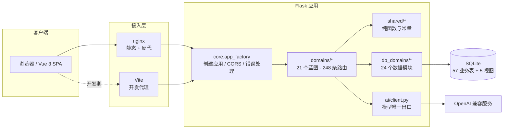

# 技术架构

本文说明系统的分层、领域边界、权限与数据模型，以及支撑这些结构的决策。术语以 [`GLOSSARY.md`](../GLOSSARY.md) 为准，历史决策以 [`docs/adr/`](adr/) 为准。

---

## 1. 设计约束

架构不是自由选择的结果，而是被以下约束推出来的：

| 约束 | 后果 |
| --- | --- |
| 单机自托管，无容器编排 | Flask 单体 + SQLite 单文件，不引入消息队列与独立缓存 |
| 六类角色共用一套前端 | 单页应用 + 路由级角色分流，不拆多套前端 |
| 内容由运营维护，不能写死在代码里 | 内容全量落库（ADR 0002），代码只保留读取与校验逻辑 |
| 竞赛与教学场景要求可复现 | 迁移脚本幂等、基线库可重建、测试不依赖外部服务 |
| 上游模型可能未配置或不稳定 | AI 调用收敛到唯一出口，未配置时明确降级，不返回伪造结果 |

## 2. 总体架构



两种运行形态：

- **开发期**：Vite（5173）伺服 SPA 并代理 `/api`、`/uploads`、`/images` 到 Flask（5000）。
- **生产期**：nginx 伺服 `frontend/dist` 与媒体目录，`/api/*` 反代到 Flask；AI 流式接口单独关闭代理缓冲。

Flask 不再伺服旧多页面前端，旧 `.html` 路径由前端路由静默重定向。

## 3. 后端分层

| 层 | 目录 | 职责 | 依赖方向 |
| --- | --- | --- | --- |
| 入口 | `backend/app.py`、`run.py` | 创建应用、健康检查、启动参数解析 | 依赖 core |
| 应用工厂 | `backend/core/` | 应用配置、会话与能力鉴权、限流、CORS、统一错误响应 | 不依赖 domains |
| 领域路由 | `backend/domains/<域>/` | 参数校验、鉴权、编排数据层与 AI 调用 | 可依赖 db_domains / shared / ai |
| 数据访问 | `backend/db_domains/<域>.py` | SQL 与事务、跨表组装 | 只依赖 db_connection |
| 共享层 | `backend/shared/` | 零领域状态的纯函数、常量、查表 | 不依赖任何领域 |
| AI 出口 | `backend/ai/client.py` | 上游调用、配置判定、流式响应 | 不依赖领域 |
| 数据基础设施 | `db_connection.py`、`db_schema.py`、`db_init.py`、`db_seed_accounts.py` | 连接、建表补列、启动编排、演示账号 | 被上层调用 |

三条硬规则：

1. **领域之间不得互相 import**。跨领域需求走共享层纯函数、对方的窄接口，或只读视图。由 `tools/check_architecture.py` 校验。
2. **共享层不感知具体领域**。放进 `shared/` 的前提是「无领域状态」，例如节气计算、朗读评分、上传上限、作物白名单。
3. **路径基准唯一**。`backend/repo_paths.py` 的 `REPO_ROOT` 指向仓库根，因为 `data/`、`uploads/`、`.env` 都在根下，不能按模块文件位置推导。

## 4. 领域清单

| 领域 | 路由前缀 | 职责 |
| --- | --- | --- |
| `agriculture` | `/api/agriculture` | 农技问答（含流式）、追问建议、农事日历、作物订阅与提醒 |
| `pest` | `/api/agriculture` | 病虫害智能诊断、速查（筛选与分页） |
| `crafts` | `/api/crafts` | 手工技艺详情、步骤、采购指南、视频 |
| `resources` | `/api/resources` | 方言语音问答、成功案例、政策信息 |
| `ecommerce` | `/api/ecommerce` | 带货话术、商品文案、客服对练 |
| `live_training` | `/api/ecommerce` | 直播实训、朗读实录分析、实训提交与历史 |
| `employment` | `/api/employment` | 岗位浏览与筛选、详情、相似推荐、投递、收藏、证书积分 |
| `employment_profile` | `/api/employment` | 能力档案、在线简历、AI 简历辅助、求职意向 |
| `auth` | `/api/auth` | 注册、登录、登出、会话校验 |
| `user_profile` | `/api/user` | 个人资料读取与修改 |
| `messages` | `/api/messages` | 站内信收发与未读数 |
| `notifications` | `/api/notifications` | 通知列表、已读标记 |
| `community` | `/api/discussions`、`/api/comments` | 讨论、评论、敏感词初筛与审核状态 |
| `public` | `/api/home`、`/api/teacher`、`/api/system-announcements` | 首页公开数据、公开教师信息、系统公告 |
| `teacher` | `/api/teacher` | 学员名册、账号绑定、AI 教学报告 |
| `teaching_support` | `/api/teacher`、`/api/student` | 实训批改、学情分析、课程与材料、3D 模型上传 |
| `enterprise` | `/api/enterprise` | 岗位管理、投递处理、招聘统计 |
| `government` | `/api/government` | 政策发布与下架、区域数据大屏 |
| `operator` | `/api/operator` | 农时、病虫害、技艺、方言、招募、案例六类内容维护 |
| `admin` | `/api/admin` | 用户管理、内容审核、全员公告、社区治理、企业认证 |
| `static_files` | 无前缀 | 静态兜底与 `/uploads`、`/images` 白名单放行 |

同一 URL 前缀可以由多个领域共享（如 `/api/agriculture` 下有 `agriculture` 与 `pest`，`/api/teacher` 下有 `public`、`teacher`、`teaching_support`）。拆分依据是**业务内聚性**，不是前缀。

## 5. 权限模型

### 5.1 角色与能力

六个角色：`student`、`teacher`、`enterprise`、`government`、`operator`、`super_admin`。

37 项能力，命名形如 `<域>.read` / `<域>.manage`，空元组表示公开。映射只在 `backend/core/permissions.py` 的 `CAPABILITIES` 里维护一份：

```python
CAPABILITIES = {
    'pest.read': (),                                   # 公开
    'pest.manage': ('operator', 'super_admin'),        # 运营与超管
    'policy.manage': ('government',),                  # 仅政府
    'job.manage': ('enterprise',),                     # 仅企业
    'user.manage': ('super_admin',),                   # 仅超管
    'review.moderate': ('super_admin',),               # 仅超管可审核
    ...
}
```

### 5.2 判定方式

```python
@bp.route('/api/operator/pest/<entry_id>', methods=['PUT'])
@require_capability('pest.manage')
def update_pest(entry_id):
    ...
```

- 未登录：默认 403「权限不足」；传 `anonymous=401` 则退回「请先登录」。
- 能力不足：403。
- 账号停用：403「账号已被停用」。
- 能力名不在表里：`KeyError`，启动期即暴露，不留运行时黑洞。

### 5.3 有意保留的边界

| 能力 | 持有者 | 原因 |
| --- | --- | --- |
| `policy.manage` | 仅 `government` | 政府控制台拒绝超管代发政策；超管看统计走 `/api/admin/dashboard` |
| `job.manage` | 仅 `enterprise` | 企业岗位归属企业自身，超管只读 |
| `course.manage` | 仅 `teacher` | 课程增删改只允许教师本人，超管只读 |
| `review.moderate` | 仅 `super_admin` | 内容审核权不下放给运营 |

运营（`operator`）是超管的子集：有内容管理权，没有用户管理与审核权。这条边界由 `tests/test_permissions.py` 的矩阵锁死。

## 6. 数据模型

### 6.1 规模

- 57 张业务表 + 3 张基础设施表（`schema_migrations`、`seed_meta`、`farming_seed_meta`）
- 5 个只读视图：`v_home_stats`、`v_enterprise_applications`、`v_enterprise_job_stats`、`v_reviewable_models`、`v_submission_context`

### 6.2 分组

| 分组 | 代表表 | 说明 |
| --- | --- | --- |
| 身份与权限 | `users`、`user_sessions` | 账号与会话 |
| 内容 | `pest_entries`、`pest_crops`、`pest_sources`、`pest_images`、`farming_tasks`、`crafts`、`craft_steps`、`dialects`、`recruitments`、`success_cases`、`government_policies` | 运营维护，代码无副本 |
| 教学 | `courses`、`course_materials`、`assignments`、`assignment_submissions`、`students`、`certificates`、`points`、`models_3d` | 课程、作业、名册、证书、积分、3D 模型 |
| 实训 | `discussions`、`comments`、`content_reviews`、`job_listings`、`job_applications`、`resumes`、`saved_jobs` | 社区、审核、岗位与投递 |
| 消息 | `messages`、`notifications`、`notification_reads` | 站内信与通知 |
| 企业 | `enterprise_qualifications`、`job_listings`、`job_applications` | 资质、岗位、投递 |
| 政府 | `government_policies`、`policies` | 政策发布与公开读取 |
| 基础设施 | `schema_migrations`、`seed_meta`、`farming_seed_meta` | 迁移记录与播种元数据 |

### 6.3 内容规模

| 内容 | 行数 |
| --- | --- |
| 病虫害条目 | 69（8 类作物、25 个来源、29 条实拍图） |
| 农事任务 | 123（8 种作物、38 个物候期） |
| 成功案例 | 5 |
| 招募公告 | 14 |
| 方言短语 | 24 |
| 手工技艺 | 4（24 个步骤、16 个视频） |

### 6.4 迁移策略

- 建表与补列只在 `db_schema.py` 定义，`apply_schema()` 幂等执行，只加不删。
- 一次性数据迁移在 `migrations/`，必须幂等并写入 `schema_migrations`。
- 内容不通过启动播种写入：`init_db()` 只建表与写演示账号，避免覆盖运营改过的数据。

## 7. 前端架构

```text
frontend/src/
├── main.ts            # 挂载：tokens → base → components → 页面域样式
├── App.vue
├── router/            # 公开路由 + 六角色后台路由 + 旧 .html 重定向
├── stores/            # Pinia：会话、能力清单、全局提示
├── api/               # axios 实例、统一错误处理、SSE 封装
├── views/             # 35 个视图（公开 11 + 后台 24）
├── components/        # 19 个业务组件（农业、电商、就业、运营、公共外壳）
├── layouts/           # 前台与后台外壳
├── shared/            # 前端共享工具与常量
└── styles/            # tokens.css / base.css / components.css / 页面域样式
```

| 关注点 | 做法 |
| --- | --- |
| 路由 | Vue Router 管理公开页与后台路径；未登录访问后台跳登录并回跳 |
| 会话 | Pinia 保存用户、角色与能力清单；能力清单由后端 `capabilities_for_role()` 下发，前端不复制权限表 |
| 请求 | axios 统一注入会话头、统一解包 `{success, data, message}`；流式问答用 `fetch` + `ReadableStream` |
| 样式 | 语义 token + 基础层 + 组件原语 + 页面域样式；禁止硬编码颜色 |
| 视觉回归 | Playwright 视觉矩阵，按页面域生成快照；样式改动需同步更新 |
| 三态 | 每个数据区块都有加载、空、错误三态，错误文案指向下一步动作 |

## 8. AI 集成

### 8.1 唯一出口

所有模型调用经过 `backend/ai/client.py`：`chat_completion()`（同步）、`chat_completion_stream()`（流式）、`vision_completion()`（多模态）。业务代码不直接使用 `requests` 调模型。

### 8.2 三条模型通道

| 变量 | 用途 | 留空的后果 |
| --- | --- | --- |
| `AI_MODEL` | 病害结构化诊断、兜底 | 有代码默认值 |
| `AI_VL_MODEL` | 图片诊断 | 关闭图片诊断，不静默降级到知识库 |
| `AI_CHAT_MODEL` | 农技问答、追问建议、方言问答 | 跟随 `AI_MODEL` |

### 8.3 降级与容错

| 场景 | 行为 |
| --- | --- |
| 未配置 `AI_API_KEY` | AI 接口返回 503 + 明确错误码；内容浏览、岗位、社区、后台不受影响 |
| 上游超时或 5xx | 返回可读错误，前端提示重试；不写入半成品数据 |
| 结构化输出不合规 | 解析失败即报错，不把残缺 JSON 当结果返回 |
| 推理模型吃光 `max_tokens` | 通过 `AI_REASONING_TOKEN_RESERVE` 预留思考余量 |
| 调用过频 | 按「用户 + 端点」滑动窗口限流（默认 300 秒），超限返回 429 |

### 8.4 内容安全

- 病虫害与农技回答带用药免责声明；检测到剂量表述时附「以标签与当地农技站为准」。
- 社区内容先过敏感词初筛，命中转人工审核（`pending`），不直接拒绝。
- 待审内容在列表、详情、评论中一律断链，审核通过后才计入评论数。

## 9. 关键决策

| 编号 | 决策 | 影响 |
| --- | --- | --- |
| [ADR 0001](adr/0001-backend-domain-split.md) | 后端按领域拆分，领域间不互相 import | `app.py` 从 6032 行降到入口职责；边界可机械校验 |
| [ADR 0002](adr/0002-content-into-database.md) | 内容数据全部落库，删除代码内副本 | 运营改内容不需要改代码；基线库成为交付物 |
| [ADR 0003](adr/0003-frontend-vue-spa.md) | 前端从多页面迁移到 Vue 3 SPA | 路由、状态、样式统一；旧页面退为只读参照 |

## 10. 非功能设计

| 关注点 | 实现 |
| --- | --- |
| 上传上限 | 唯一常量 `shared/upload_limits.py`（50 MB）；前端常量由 `tools/sync_upload_limit.py` 同步；nginx `client_max_body_size` 由契约测试比对 |
| 错误契约 | 统一 `{success, code, message}`；传输层 413 也返回机器可读错误码 |
| 会话安全 | 服务端会话表 + `X-Session-Id`；密码散列与校验同一份实现；停用账号即时失效 |
| 跨域 | 默认只放行本机来源；生产同源，不开放宽泛 CORS |
| 静态资源 | 只放行 `uploads/` 与 `images/`；`data/` 整目录拒绝，资质证件只经鉴权接口下发 |
| 可观测性 | `/api/health` 探针；启动日志打印端口来源与 AI 配置状态；关键拒绝路径有明确 message |
| 依赖治理 | 后端仅 5 个直接依赖；机械检查覆盖未用导入与未定义名 |
